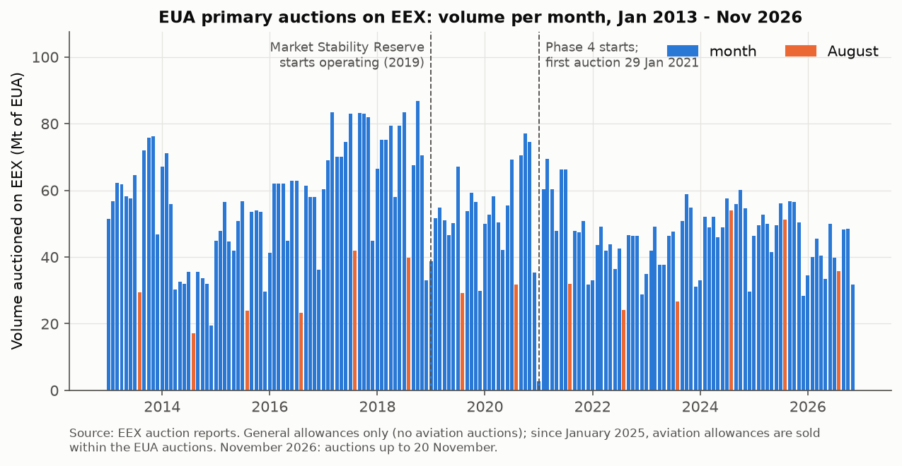
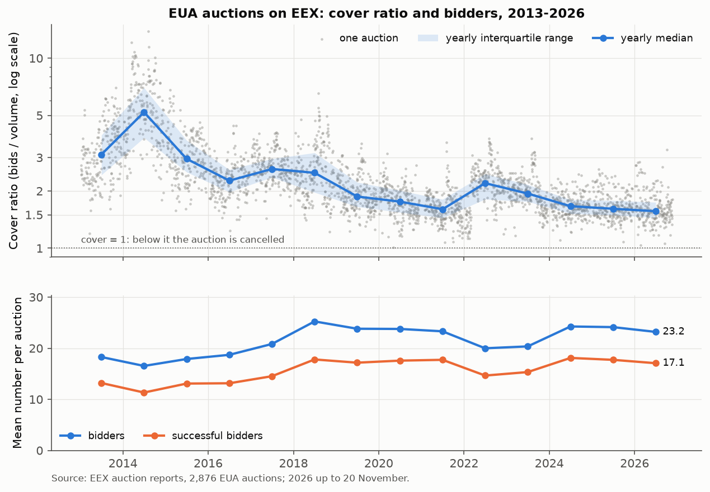
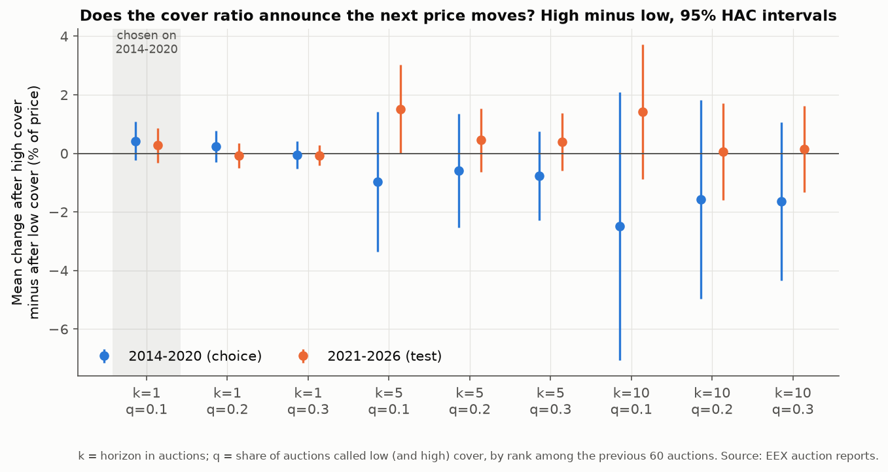

# EU ETS auctions on EEX: supply, demand, and whether the cover ratio predicts prices

> **In short.** 2,876 EU allowance auctions on EEX, 2013-2026. *Supply:* an August auction offered half the volume
> of a July auction until 2023; the volume auctioned falls by 35% in 2014, the first year of backloading, and by 28%
> in 2019, the first year of the Market Stability Reserve. *Demand:* the median cover ratio peaks at 5.20 in 2014 and
> falls to 1.57 in 2026. *Test:* the out-of-sample test (variant chosen on 2014-2020, judged once on 2021-2026) finds
> no evidence that the cover ratio predicts the next clearing prices (t = 0.92, p = 0.36).

Three questions on the public results of the primary auctions of EU emission allowances (EUA) held on EEX,
from 7 January 2013 to 20 November 2026 (2,876 auctions):

1. **Supply.** How much is auctioned each month, and which policy changes can be seen in the volumes?
2. **Demand.** What do the cover ratio, the number of bidders and the bid dispersion say, year by year?
3. **A test.** Does a low or high cover ratio announce the change in the clearing price over the next auctions?
   Parameters are chosen on 2014-2020 and judged once on 2021-2026.

## Data and cleaning

EEX publishes one spreadsheet per year (`.xls` until 2019, `.xlsx` since). EEX runs the common auction platform
and the auctions of Germany, Poland and Northern Ireland; auctions held on other platforms are not in these files.
The layout changes over the years: the header is on line 3 until 2016 and on line 6 from 2017, a status column
appears in 2020, and the 2026 file names its sheet "EU ETS1". `src/eua_auctions/data.py` locates the header by
its "Date" cell and maps every spelling of a column to one name.

| Rule | Rows |
|---|---|
| Rows read from the 15 files (2012-2026) | 3,044 |
| Phase-2 EUAs (contract `T2PA`), 3 January 2012 to 25 April 2013 | −64 |
| Aviation allowances (1 `EAA2`, 81 `EAA3`, the last on 11 December 2024). Since January 2025, aviation allowances are sold within the EUA auctions ([EEX customer information, 31 July 2024](https://eex.com/fileadmin/Global/News/EEX/EEX_Customer_Information/2024/20240731_CI_Auction_Calendar_revised_2024_and_2025.pdf)) | −82 |
| Cancelled auctions (17 March 2020, 1 February 2022, 2 March 2022) | −3 |
| Phase-3 EUAs auctioned in 2012, before phase 3 began | −19 |
| Missing prices or volumes, duplicates | 0 |
| **Kept: EUA auctions, 7 January 2013 to 20 November 2026** | **2,876** |

The kept auctions are 1,949 on the common platform, 636 for Germany, 285 for Poland and 6 for Northern Ireland.
EEX keeps the contract code `T3PA` for phase-4 EUAs (the auction names say "4. Period" from 2021), so the filter
is on `T3PA`. No EU ETS2 auction is in the files; a future ETS2 sheet would be ignored. The cover ratio is
recomputed as total bids / volume and matches EEX's rounded figure on every row (largest gap 0.005).

## 1. Supply

| | 2013 | 2014 | 2015 | 2016 | 2017 | 2018 | 2019 | 2020 | 2021 | 2022 | 2023 | 2024 | 2025 | 2026* |
|---|---|---|---|---|---|---|---|---|---|---|---|---|---|---|
| auctions | 202 | 194 | 195 | 187 | 201 | 203 | 208 | 209 | 223 | 213 | 215 | 213 | 213 | 200 |
| volume (Mt) | 713.0 | 462.2 | 557.8 | 635.0 | 845.2 | 814.7 | 588.5 | 667.5 | 583.0 | 482.4 | 517.6 | 592.8 | 588.7 | 447.9 |
| per auction (Mt) | 3.53 | 2.38 | 2.86 | 3.40 | 4.21 | 4.01 | 2.83 | 3.19 | 2.61 | 2.26 | 2.41 | 2.78 | 2.76 | 2.24 |

\* 2026: auctions up to 20 November.



- **August.** On each platform, an August auction offered half the volume of a July auction from 2013 to 2023 and
  the same volume from 2024. The ratio of the median August auction to the median July auction is 0.50 in 28 of the
  30 platform-years of 2013-2023 (0.51 on the common platform in 2013; 0.60 for Poland in 2016, with one auction in
  each month) and 1.00 in all 9 platform-years of 2024-2026. Regulation (EU) No 1031/2010 halved August volumes on
  the common auction platform ([Art. 8(5)](https://eur-lex.europa.eu/legal-content/EN/TXT/?uri=CELEX:32010R1031)); Delegated Regulation (EU) 2023/2830, in force since
  21 December 2023, spreads them evenly over the year ([Art. 8(5)](https://eur-lex.europa.eu/legal-content/EN/TXT/?uri=CELEX:32023R2830)).
- **2014.** The volume falls by 35.2% from 2013: the years 2014 to 2016 are those of "backloading", when the
  European Commission withheld allowances from the auctions
  ([Commission page](https://climate.ec.europa.eu/eu-action/carbon-markets/eu-emissions-trading-system-eu-ets/market-stability-reserve_en)).
  The Commission's figures cover all platforms, so they are not compared with the EEX volumes here.
- **2019.** The volume falls by 27.8% from 2018 (29.5% per auction), the year the Market Stability Reserve
  "began operating" ([same page](https://climate.ec.europa.eu/eu-action/carbon-markets/eu-emissions-trading-system-eu-ets/market-stability-reserve_en)).
  The files give what each auction offered, not what was withheld from it, so no reserve intake is computed here.
- **2021.** Phase 4 starts with a first auction on 29 January; the volume is 12.7% below 2020.

## 2. Demand

| year | median cover ratio | auctions with cover < 1.5 | bidders (mean) | successful bidders (mean) | price − mean bid, median (% of price) |
|---|---|---|---|---|---|
| 2013 | 3.11 | 1.0% | 18.3 | 13.2 | 3.84 |
| 2014 | 5.20 | 0.0% | 16.5 | 11.3 | 7.65 |
| 2015 | 2.95 | 0.0% | 17.9 | 13.1 | 0.27 |
| 2016 | 2.27 | 2.7% | 18.7 | 13.1 | 1.81 |
| 2017 | 2.61 | 0.5% | 20.8 | 14.5 | 2.96 |
| 2018 | 2.49 | 2.0% | 25.2 | 17.8 | 3.85 |
| 2019 | 1.87 | 7.7% | 23.8 | 17.2 | 0.37 |
| 2020 | 1.76 | 18.2% | 23.8 | 17.6 | −0.45 |
| 2021 | 1.60 | 32.7% | 23.3 | 17.7 | −0.07 |
| 2022 | 2.20 | 11.7% | 20.0 | 14.7 | 0.71 |
| 2023 | 1.94 | 7.4% | 20.4 | 15.3 | 0.05 |
| 2024 | 1.66 | 19.2% | 24.3 | 18.1 | −1.05 |
| 2025 | 1.61 | 27.2% | 24.1 | 17.7 | −0.27 |
| 2026* | 1.57 | 35.5% | 23.2 | 17.1 | 0.89 |

- **Cover ratio** = total volume bid / volume offered. Below 1 the auction is cancelled (Article 7 of
  [Regulation (EU) 2023/2830](https://eur-lex.europa.eu/legal-content/EN/TXT/?uri=CELEX:32023R2830)). The median
  peaks at 5.20 in 2014, the full year with the smallest volume offered, and falls to 1.57 in 2026, when 35.5% of
  auctions receive bids for less than 1.5 times the volume offered. The ratio divides by the volume offered: the
  same bids give a higher ratio when less is offered.
- **Bidders.** Between 16.5 (2014) and 25.2 (2018) bidders per auction on average; 23.2 in 2026.
- **Price − mean bid.** Bids above the clearing price are filled and bids below it are rejected, so a mean bid
  far below the clearing price means many low bids: wide dispersion. The median over all auctions is 0.49% of the
  price, and the spread is larger when the cover is higher (rank correlation 0.62), partly by construction. EEX's
  mean includes erroneous bids: on 11 June 2024 one maximum bid of 7,075 EUR/t lifts the mean bid to 137.30 EUR/t
  for a clearing price of 70.31 EUR/t. That is why the yearly figure is a median.



## 3. Does the cover ratio announce the next price moves?

**Design, committed in `ce81313`, before the results commit `87593fa`** (see
`src/eua_auctions/cover_signal.py`, unchanged since):

- Signal: the rank of an auction's cover ratio among the previous 60 auctions. The median cover falls from 5.20
  (2014) to 1.76 (2020) inside the training years, so fixed thresholds on the raw ratio would mostly sort auctions
  by year. "Low cover" is a rank in the bottom share q, "high cover" a rank in the top share q.
- Target: the change in the clearing price over the next k auctions, 100 × ln(P[t+k] / P[t]). The cover ratio and
  the price of auction t are published together, so the signal is known when P[t] is.
- Choice on 2014-2020 among 9 variants (k = 1, 5, 10 auctions; q = 0.1, 0.2, 0.3): the largest |t| of the
  difference between the mean change after high and after low cover. A training auction is kept only if its
  target auction is also in 2020: the last target is 14 December 2020.
- Standard errors: Newey-West (HAC) with 2k lags. Ten variants were run in all: the 9, and one robustness check.

On 2014-2020, no variant is significant (largest |t| 1.26, every p above 0.2). The chosen one is k = 1, q = 0.1:

| change in the clearing price at the next auction | 2014-2020 (choice) | 2021-2026 (test) |
|---|---|---|
| auctions (low cover / high cover) | 1,396 (194 / 163) | 1,276 (175 / 149) |
| mean change after low cover | −0.07% | −0.03% |
| mean change after high cover | +0.35% | +0.25% |
| mean change, all auctions | +0.14% | +0.07% |
| high − low, 95% HAC interval | +0.42% [−0.24, +1.08], t = 1.26 | **+0.28% [−0.31, +0.87], t = 0.92, p = 0.36** |

- **Against a naive forecast.** Forecasting each 2021-2026 change by the 2014-2020 mean of its bucket gives a
  root mean squared error of 2.57%, the same as forecasting no change: out-of-sample R² +0.05%, Diebold-Mariano
  p = 0.89. Against the 2014-2020 mean of all auctions: R² +0.05%, p = 0.85.
- **Robustness.** Measured from the next auction (P[t+1] to P[t+2]), leaving out the signal auction's own price,
  the difference is −0.47% on 2014-2020 (t = −1.29) and +0.36% on 2021-2026 (t = 1.24): the sign is not stable.
- **The other 8 variants on 2021-2026**, shown for transparency and not used for any choice
  (`results/cover_signal.json`): the largest is k = 5, q = 0.1, +1.51% with t = 1.94 (p = 0.053). Its sign on
  2014-2020 was the opposite (−0.97%), and after 9 tries a p-value of 0.05 is no evidence: the Bonferroni threshold
  for 9 tries at 5% is 0.0056.

**Answer: no evidence.** Neither on the years where it was chosen nor on the years where it was tested does the
cover ratio announce the change in the clearing price over the next 1, 5 or 10 auctions. One reading, not tested
here: the results of an auction are public on the day, and the secondary market prices them before the next
auction.



## Limitations

- **EEX only.** The volumes are those auctioned on EEX, not the EU total.
- **No secondary-market price.** The usual demand indicator is the auction's discount to the secondary market; it
  needs secondary-market prices, which are not used here. The price changes in question 3 are between clearing
  prices, so they include each auction's own discount.
- **The cover ratio is relative to the volume offered**, which policy sets. The rank against the previous 60 auctions
  removes slow changes, not the gap between platforms: on 2014-2020 the median cover is 2.49 on the common
  platform and 2.10 for Poland.
- **The cover rank also tracks the volume offered:** August auctions are 29% of the high-cover bucket of the
  chosen variant (9% of all auctions, 2014-2026); on 2021-2026, German auctions are 56% of it (21% of all). This
  was measured after the test, as a description (`results/cover_signal.json`).
- **Causes are not separated.** The changes in volume are described, not decomposed into reserve intake,
  backloading or other policy decisions.
- **2026 is partial**, and the 2026 file grows after each auction: the window stops at 20 November 2026.

## Reproduce

```
uv sync --group dev
uv run python scripts/download.py       # EEX files into data/raw/, a few seconds
uv run python scripts/clean.py          # cleaning report
uv run python scripts/supply.py         # question 1
uv run python scripts/demand.py         # question 2
uv run python scripts/cover_signal.py   # question 3
uv run pytest
```

The numbers are written to `results/` and the figures to `figures/`.

## Code

| | |
|---|---|
| `src/eua_auctions/data.py` | download, reading of the yearly layouts, cleaning rules and their report |
| `src/eua_auctions/supply.py` | monthly and yearly volumes, August against July |
| `src/eua_auctions/demand.py` | cover ratio, bidders and price − mean bid by year |
| `src/eua_auctions/cover_signal.py` | trailing rank, forward changes, the training choice, HAC tests, forecast comparison |
| `scripts/` | one script per question, plus download and cleaning |
| `tests/` | hand-computable cases: cleaning on a hand-built sheet, rank and forward change by hand, and two tests that the training choice never sees the test years |

## Data and terms of use

The data are EEX's "EUA Emission Spot Primary Market Auction Report" files, published on the
[EEX auctions page](https://www.eex.com/en/markets/environmental-markets/eu-ets-auctions). © EEX AG. Files downloaded
on 21 November 2026, not redistributed: `data/` is not versioned, and `scripts/download.py` fetches them from EEX.
Only aggregates and charts computed from them are published, for non-commercial research. EEX's terms:
https://www.eex.com/en/legal-information/disclaimer.

The MIT licence covers the code only; `results/` and `figures/` are derived from EEX data (© EEX AG), see above.

## How this project was built

The code was written by an AI coding agent (Claude Code) under the direction of the author, Guillaume Beaudouin.
Every number on this page is produced by the scripts above.
